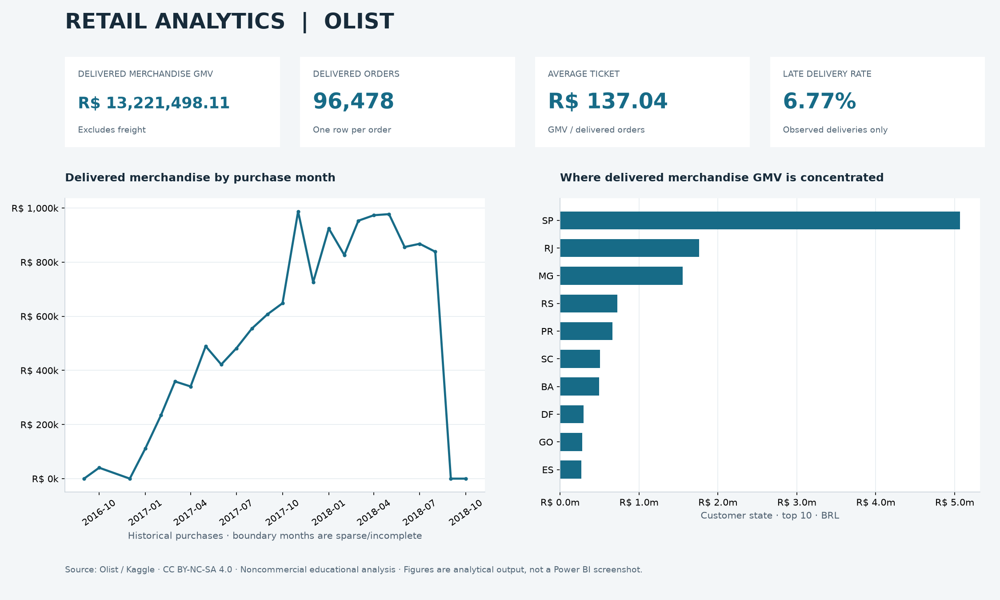
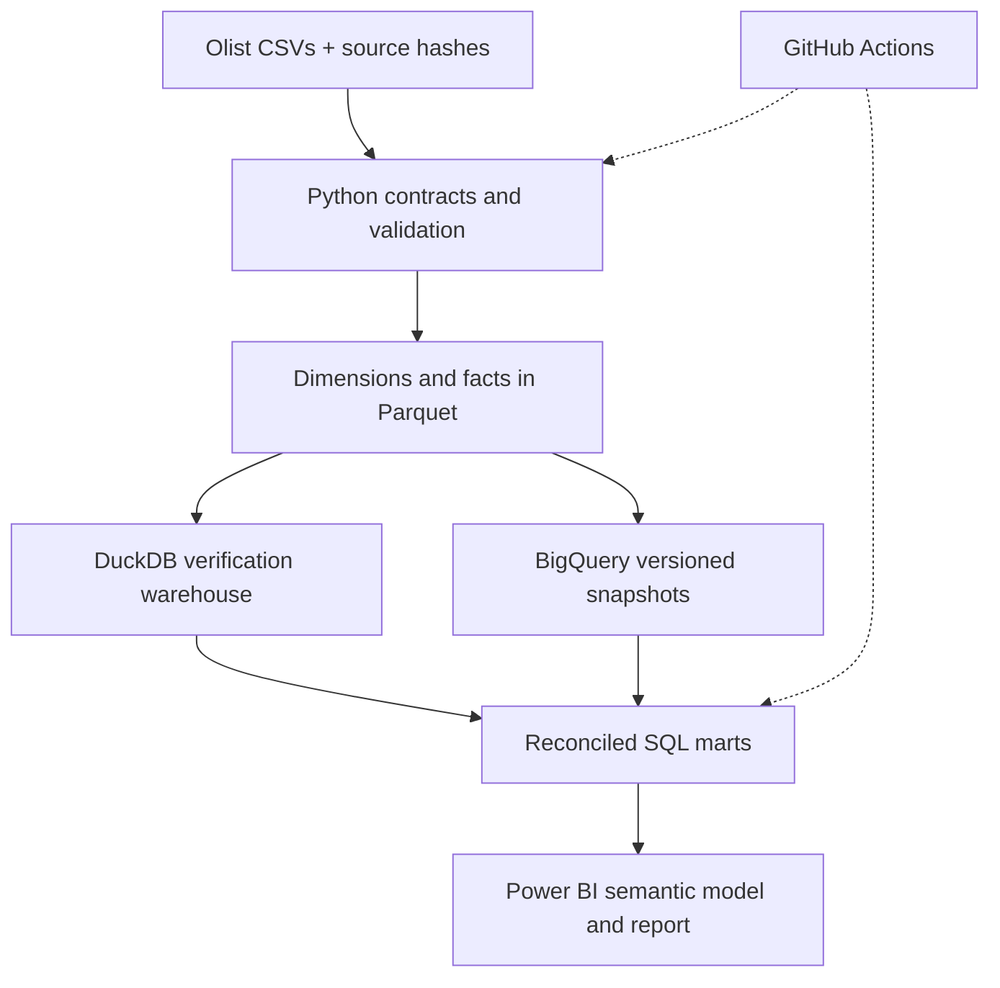
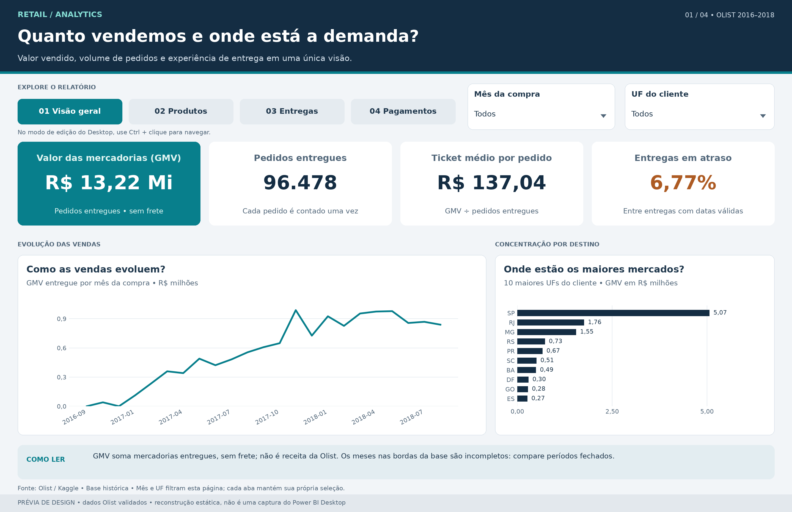

# Retail Analytics — End-to-End Data Project

[](https://github.com/Pedroferreira32/retail-analytics-end-to-end/actions/workflows/ci.yml)


[Português](README.pt-BR.md) · [Italiano](README.it.md) · [Español](README.es.md)

I built this project to connect business questions to a reproducible data pipeline, a dimensional warehouse and an executive Power BI report. I used the real, anonymized **Brazilian E-Commerce Public Dataset by Olist**, covering purchases from September 2016 to October 2018.

My main engineering challenge was preserving the right grain: an order can contain several items, payments and reviews. Joining those raw tables directly inflates sales. I aggregated each relationship deliberately and reconciled the results in SQL before publishing a run.

## Business questions

- How much merchandise value came from delivered orders, and how did it vary by month, category and customer state?
- Which regions combine commercial relevance with slower or late deliveries?
- How do delivery outcomes relate to customer ratings, and how complete is rating coverage?
- Do recorded payments reconcile with item prices plus freight?
- How many customers purchased again within this historical observation window?

## Verified results on the complete dataset

| Indicator | Result |
| --- | ---: |
| Placed orders, all statuses | 99,441 |
| Delivered orders | 96,478 |
| Delivered merchandise GMV, excluding freight | R$ 13,221,498.11 |
| Average delivered-order ticket, excluding freight | R$ 137.04 |
| Observed valid deliveries | 96,470 |
| Late deliveries, after the promised calendar date | 6,534 / 96,470 (6.77%) |
| Average latest rating, delivered orders with a rating | 4.16 / 5 |

GMV is merchandise value, **not Olist revenue or profit**. Payment totals include every status and have a different business scope. Edge months are incomplete or sparse; the last months cannot be interpreted as a real business collapse. [Inspect the evidence and limitations](docs/evidence/README.md).



## Architecture



DuckDB is the local execution and verification target. BigQuery is the cloud warehouse target; it is not replaced by a local database. The Power BI model imports the conformed facts and dimensions, while SQL marts provide independently inspectable aggregate evidence.

## Delivery status

| Component | Status |
| --- | --- |
| Complete Olist dataset extraction, profiling and Python ETL | Executed and reconciled locally and in [GitHub Actions](https://github.com/Pedroferreira32/retail-analytics-end-to-end/actions/runs/43622267281) |
| Dimensional model, Parquet/CSV exports and SQL marts | Executed on the complete dataset |
| Unit/integration tests, coverage, lint and packaging | Automated in CI |
| Live BigQuery warehouse and cloud reconciliation | Published in `retail-analytics-514717` via Cloud Shell; [CLI screenshot and 11 reconciled row counts](docs/evidence/bigquery-cli-receipt.json) |
| BigQuery publication from GitHub Actions using WIF | Workflow implemented; IAM/WIF provisioning and hosted cloud execution remain pending |
| Power BI PBIP/PBIR, M queries, model and DAX measures | Generated; JSON schemas and bindings checked |
| Power BI Desktop acceptance and PBIX export | Initial executive page rendered in the user's Desktop; redesigned layout, full DAX/filter acceptance and PBIX export pending |
| Power BI Service publication | Requires a connected account/workspace |

These are separate verification levels. A passing metadata test is not evidence of a successful Desktop refresh or cloud deployment.

## Run in five minutes

Requires Python 3.11 or 3.12. Run commands from the repository root. In Windows PowerShell, activate the environment using `.venv\Scripts\Activate.ps1`.

```bash
python -m venv .venv
source .venv/bin/activate
python -m pip install -r requirements-dev.lock
python -m pip install --no-deps -e .

# Fast, offline demonstration — explicitly synthetic fixture data.
retail run --raw-dir tests/fixtures/olist --output-dir artifacts/demo --source-kind synthetic

# Real historical dataset from its original publisher.
retail download --raw-dir data/raw
retail run --raw-dir data/raw --output-dir data/processed --source-kind olist
python scripts/prepare_powerbi.py
```

The original download is about 45 MB compressed. Raw CSVs, local exports and credentials are ignored by Git. The downloader checks the archive contents and refuses to overwrite a changed source file.

Each successful run creates `data/processed/runs/<run_id>/` with Parquet, CSV, a DuckDB database, source fingerprints, a quality report, a reconciliation report and KPI results. `latest.json` advances only after the entire run passes. Re-running the same inputs produces the same analytical data in a new auditable run.

## Validate

```bash
ruff check .
ruff format --check .
pytest --cov=retail_analytics --cov-report=term-missing
python scripts/validate_powerbi.py
python -m build
```

CI runs on Linux (Python 3.11/3.12) and Windows (3.12). It requires no Kaggle or GCP credentials. The full-dataset and BigQuery workflows are manually triggered because this is a fixed historical dataset, not a live sales feed.

## BigQuery and Power BI

```bash
gcloud auth application-default login
retail bigquery --project YOUR_PROJECT_ID --dataset retail_analytics --location US
```

The cloud command creates an isolated snapshot, loads partitioned/clustered facts, builds SQL marts, checks row counts and monetary totals, then advances canonical views. Queries have a bytes-billed cap. [Cloud setup, IAM and rollback](docs/bigquery.md).

Open [powerbi/RetailAnalytics.pbip](powerbi/RetailAnalytics.pbip) in Power BI Desktop, set `DataFolder` to the absolute `powerbi/data` directory and refresh. Alternatively choose `DataSourceMode=BigQuery` and set `BillingProject` and `BigQueryDataset`. The report contains four pages and 20 documented measures. [Power BI setup and acceptance checks](powerbi/README.md).

The [redesigned layout](docs/powerbi-layout.md) adds business questions, metric explanations, page navigation, dropdown filters and an embedded theme. The report-only updater preserves an existing model and its configured source. The image below is a **static design preview, not a Desktop screenshot**.



## Repository guide

| Path | Purpose |
| --- | --- |
| `src/retail_analytics/` | Extraction, contracts, quality, transformations, loading and CLI |
| `sql/marts/` | Monthly sales, categories, states and historical customer RFM |
| `sql/analysis/` | Executive, payment, delivery and repeat-customer analysis |
| `tests/` | Synthetic fixtures and business/engineering regression tests |
| `powerbi/` | PBIP/PBIR report, semantic model, DAX, M parameters and schemas |
| `.github/workflows/` | CI, full Olist execution and authenticated BigQuery publication |
| `docs/` | Architecture, metric definitions, data dictionary, decisions and evidence |

## Decisions worth reviewing

- I use **integer BRL cents** throughout the ETL and SQL to avoid binary floating-point currency errors.
- I distinguish `customer_id` (order-level customer key) from `customer_unique_id` (repeat-customer identity).
- I select the latest review per order deterministically instead of incorrectly requiring a globally unique `review_id`.
- I collapse repeated geolocation ZIP prefixes before joining dimensions.
- I measure lateness against the **promised calendar date**, with only observed valid deliveries in the denominator.
- I preserve legitimate source anomalies, expose them in quality evidence and never force payment differences to zero.
- I use source timestamps as timezone-unspecified local civil times; I do not invent a UTC conversion.

[Architecture and grains](docs/architecture.md) · [Metric contract](docs/metrics.md) · [Data dictionary](docs/data-dictionary.md) · [Quality rules](docs/data-quality.md) · [Decision log](docs/decisions.md) · [Publication checklist](docs/publication.md)

## Attribution and licenses

Data: **Olist, Brazilian E-Commerce Public Dataset by Olist**, [Kaggle](https://www.kaggle.com/datasets/olistbr/brazilian-ecommerce), **CC BY-NC-SA 4.0**. I use this dataset for a noncommercial educational portfolio. Raw data is not redistributed in this repository; derived Olist analyses and figures retain the dataset attribution and license. [Data license](DATA_LICENSE.md).

Original project code: [MIT](LICENSE). Vendored Microsoft JSON schemas retain their upstream [MIT license](powerbi/schemas/LICENSE). This is an independent project and is not affiliated with Olist, Google or Microsoft.

**Author:** [Pedro Aurélio Gonçalves Ferreira](https://github.com/Pedroferreira32)
