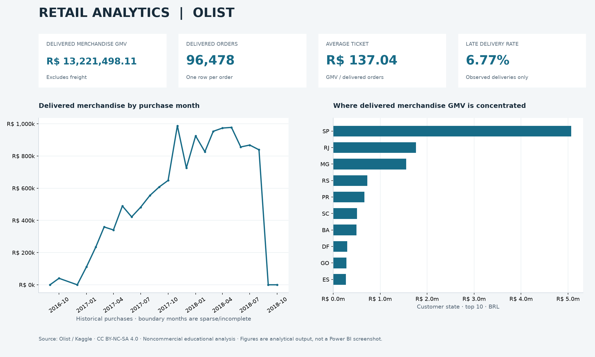

# Retail Analytics — Projeto de Dados End-to-End

[English](README.md) · [Italiano](README.it.md) · [Español](README.es.md)

Desenvolvi este projeto para transformar dados reais de comércio eletrônico em indicadores comerciais e de experiência do cliente. Usei o **Brazilian E-Commerce Public Dataset by Olist** e construí o caminho de extração, qualidade, modelagem dimensional, SQL e consumo no Power BI.

O principal cuidado foi respeitar o grão de cada tabela. Um pedido pode ter vários itens, pagamentos e avaliações. Ao agregá-los antes das junções, evitei multiplicar valores e validei os totais em diferentes camadas.

## Resultados verificados na base completa

| Indicador | Resultado |
| --- | ---: |
| Pedidos realizados, todos os status | 99.441 |
| Pedidos entregues | 96.478 |
| GMV de mercadorias entregues, sem frete | R$ 13.221.498,11 |
| Ticket médio de mercadorias por pedido entregue | R$ 137,04 |
| Entregas observadas com datas válidas | 96.470 |
| Entregas após a data prometida | 6.534 (6,77%) |
| Nota média da última avaliação por pedido entregue avaliado | 4,16 / 5 |

O GMV representa o valor das mercadorias entregues; não é receita ou lucro da Olist. Os meses nas bordas da base são esparsos/incompletos e exigem cuidado nas comparações. Os pagamentos registrados incluem outros status e possuem um escopo diferente do GMV.



## O que implementei

- ETL Python/pandas modular, com CLI, contratos de entrada e rastreabilidade por SHA-256.
- Validação de tipos, chaves, relacionamentos, valores monetários e regras de qualidade.
- Quatro dimensões e três fatos, com valores monetários em centavos inteiros.
- Warehouse local DuckDB para reproduzir a execução e conferir as regras SQL.
- Carga BigQuery com snapshots, particionamento, clustering e reconciliação antes da promoção de views.
- Marts SQL de vendas mensais, categorias, estados e RFM histórico por cliente.
- Projeto Power BI PBIP/PBIR com quatro páginas, 20 medidas DAX e parâmetros CSV/BigQuery.
- Testes automatizados, cobertura mínima de 80%, lint, empacotamento e GitHub Actions para Linux/Windows.
- Documentação técnica, evidências agregadas e READMEs em quatro idiomas.

## Executar

Requer Python 3.11 ou 3.12. No PowerShell, ative o ambiente com `.venv\Scripts\Activate.ps1`; em Linux/macOS, use `source .venv/bin/activate`.

```bash
python -m venv .venv
python -m pip install -r requirements-dev.lock
python -m pip install --no-deps -e .

# Exemplo rápido, explicitamente sintético.
retail run --raw-dir tests/fixtures/olist --output-dir artifacts/demo --source-kind synthetic

# Base real, obtida do publicador original.
retail download --raw-dir data/raw
retail run --raw-dir data/raw --output-dir data/processed --source-kind olist
python scripts/prepare_powerbi.py

pytest --cov=retail_analytics --cov-report=term-missing
python scripts/validate_powerbi.py
```

Os dados originais não são modificados. Cada execução bem-sucedida gera uma pasta com Parquet, CSV, banco DuckDB, resumo de indicadores, qualidade, reconciliação e manifesto. Uma execução com erro não substitui a referência da última execução válida.

## Estado das entregas

| Etapa | Situação |
| --- | --- |
| ETL, SQL, qualidade e reconciliação da base real completa | Executados localmente |
| Testes, lint e empacotamento | Automatizados em CI |
| Publicação real no BigQuery e reconciliação na nuvem | Concluídas no projeto `retail-analytics-514717`; [evidência do terminal e 11 contagens conferidas](docs/evidence/bigquery-cli-receipt.json) |
| Publicação BigQuery pelo GitHub Actions com WIF | Workflow implementado; configuração IAM/WIF e execução na nuvem pelo GitHub ainda pendentes |
| Metadados, relacionamentos e vínculos dos visuais Power BI | Validados automaticamente |
| Atualização no Power BI Desktop e exportação PBIX | Dependem da validação no Desktop Windows |
| Publicação no Power BI Service | Depende de conta/workspace conectado |

Não trato teste com cliente simulado ou validação de JSON como prova de publicação na nuvem. Os limites de cada etapa estão registrados.

## Documentação

| Tema | Link |
| --- | --- |
| Visão geral e arquitetura | [README principal](README.md) e [arquitetura](docs/architecture.md) |
| Regras dos indicadores | [Contrato de métricas](docs/metrics.md) |
| Estrutura dos dados | [Dicionário](docs/data-dictionary.md) |
| Qualidade e achados da base | [Validação](docs/data-quality.md) |
| Resultados reproduzíveis | [Evidências](docs/evidence/README.md) |
| Implantação na nuvem | [BigQuery e IAM/WIF](docs/bigquery.md) |
| Abertura e atualização do relatório | [Power BI](powerbi/README.md) |
| Próximas validações de publicação | [Checklist](docs/publication.md) |

Dados: **Olist**, [Kaggle](https://www.kaggle.com/datasets/olistbr/brazilian-ecommerce), **CC BY-NC-SA 4.0**. Uso educacional e não comercial. Código original sob licença MIT; resultados derivados mantêm a atribuição e a licença dos dados.

**Autor:** Pedro Aurélio Gonçalves Ferreira · [GitHub](https://github.com/Pedroferreira32).
