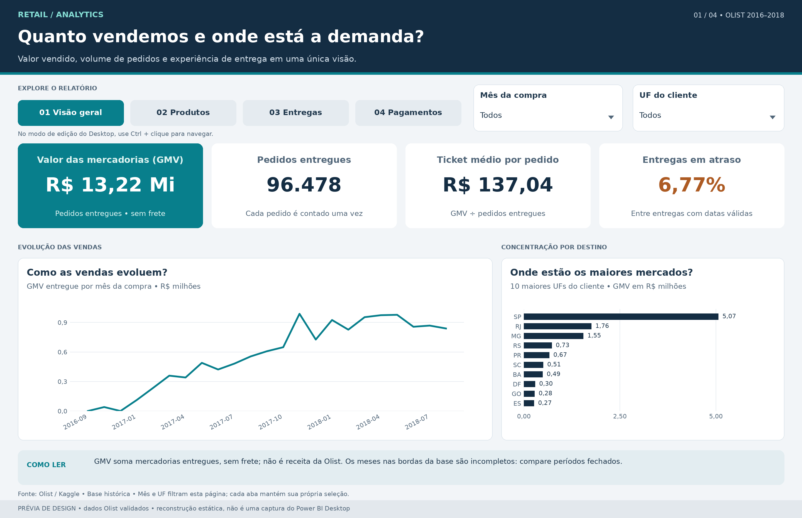
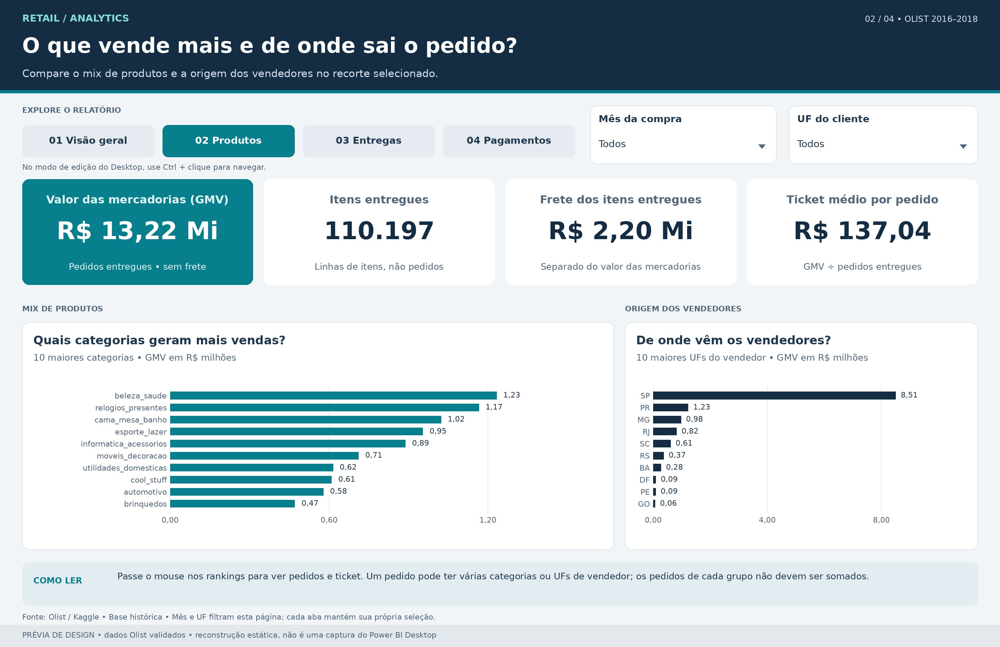
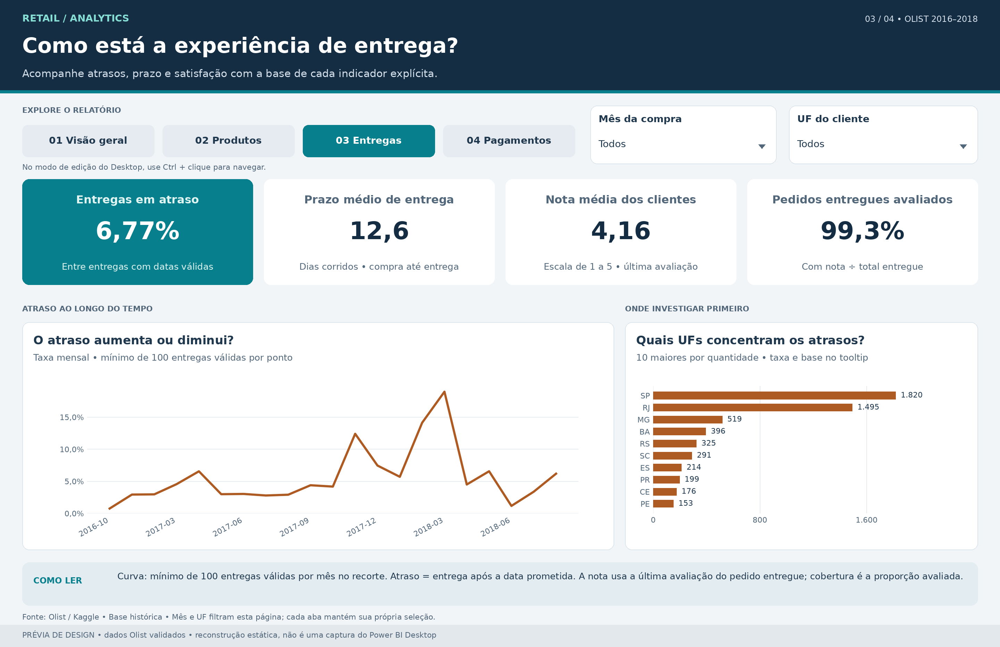
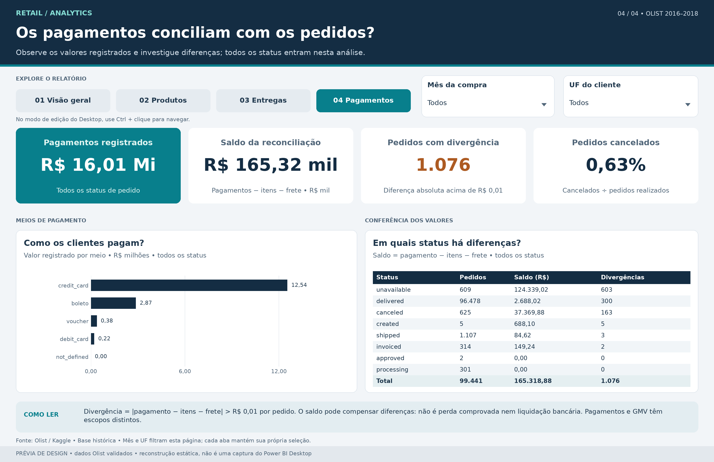

# Layout do Retail Analytics

Quatro páginas organizadas por perguntas de negócio, com filtros visíveis, números contextualizados e explicações dos cálculos.

| Página | Pergunta | Conteúdo |
| --- | --- | --- |
| Visão executiva | Quanto vendemos e onde está a demanda? | GMV, pedidos entregues, ticket, atraso, evolução mensal e dez maiores UFs de destino. |
| Produtos e regiões | O que vende mais e de onde sai o pedido? | Itens e frete, dez maiores categorias e UFs de vendedor; pedidos e ticket no tooltip. |
| Entregas e satisfação | Como está a experiência de entrega? | Atraso, prazo, nota, cobertura, evolução mensal com base mínima e UFs com maior volume de atrasos. |
| Pagamentos e qualidade | Os pagamentos conciliam com os pedidos? | Valor registrado, saldo, divergências, cancelamento, meios de pagamento e conferência por status. |

O azul escuro organiza a navegação e os títulos. O verde destaca o indicador principal e as vendas. O tom âmbar diferencia atraso e divergência, sem afirmar que uma meta foi descumprida. Os cartões esclarecem a população e a unidade; o rodapé destaca limites de interpretação.

Os filtros de mês da compra e UF do cliente são listas suspensas com seleção múltipla e seleção de todos. Eles atuam na página atual; as páginas mantêm suas próprias seleções. Os botões superiores navegam entre páginas; no modo de edição do Desktop, use Ctrl + clique.

O gráfico mensal de atraso omite pontos com menos de 100 entregas observadas no recorte atual. O número é um limite de apresentação para reduzir a distorção por bases muito pequenas; não é uma garantia de significância estatística e não altera o cálculo dos cartões. Os rankings são limitados aos dez maiores grupos no contexto dos filtros. Pedidos por categoria e por UF de vendedor não são aditivos, pois um pedido pode aparecer em mais de um grupo.

Para aplicar a revisão mantendo o modelo que já funciona, siga o [passo a passo do atualizador](../powerbi/README.md#atualizar-o-layout-de-um-projeto-que-já-funciona).

## Prévias de desenho

As imagens abaixo são reconstruções estáticas das posições, cores e textos PBIR, com agregações dos dados Olist validados. **Não são capturas do Power BI Desktop nem prova de execução do DAX.** Fonte, espaçamento e detalhes dos controles podem variar no Desktop. O rodapé de cada imagem identifica a prévia.









Para reproduzir as prévias após executar o pipeline Olist completo:

```bash
python scripts/build_powerbi.py
python scripts/render_powerbi_design.py
python scripts/validate_powerbi.py
```

O gerador usa os mesmos 20 cálculos e o mesmo modelo TMSL da versão anterior. A revisão do layout não publica no Power BI Service nem substitui a aceitação dos filtros e gráficos no Desktop.
